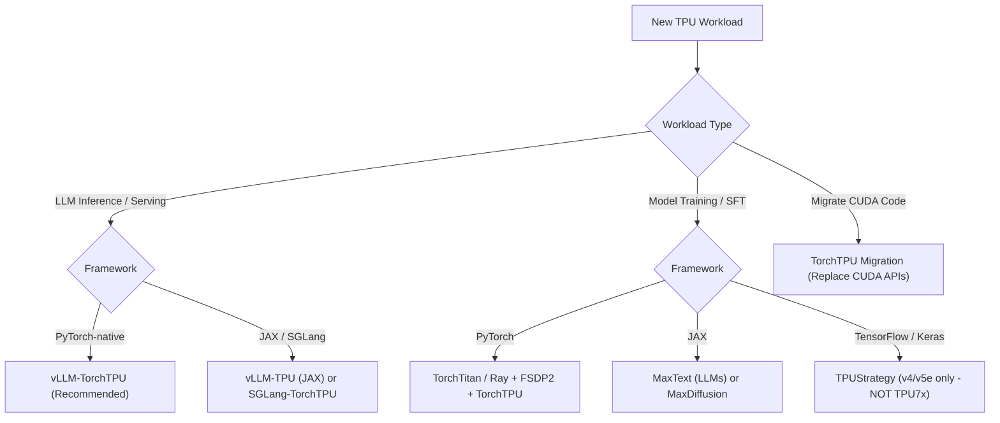

# TPU Master Orchestration Agent Skill

This skill guides AI agents and engineers through end-to-end operations on Google Cloud TPUs, spanning hardware selection, Compute Engine provisioning, NVIDIA-to-TPU code migration, high-throughput LLM serving via vLLM-TorchTPU, and distributed model training with TorchTitan and MaxText.

---

## 1. Quick Reference & Core Directives

1. **Migrate the Workload, Not the Hardware**:
   - Google recommends **TorchTPU** for new PyTorch workloads.
   - **PyTorch/XLA is deprecated** and replaced by TorchTPU.
   - For LLM serving, use **vLLM-TorchTPU** (PyTorch native out-of-tree plugin) or vLLM-TPU (JAX native). Do not mix their dependencies.
2. **Hardware & Framework Compatibility**:
   - **TPU v6e (Trillium)**: Supports TorchTPU and JAX; cost-effective default for LLM serving & fine-tuning.
   - **TPU7x (Ironwood)**: Recommended for highest performance PyTorch & JAX; **DOES NOT support TensorFlow**.
   - **Legacy APIs**: The Cloud TPU API (`gcloud compute tpus create`) is deprecated. All modern provisioning must use Compute Engine (`gcloud compute tpus tpu-vm ...` or `gcloud compute instances ...`).
3. **Compilation Caching is Mandatory**:
   - Always set `TORCH_TPU_TIER3_COMPILATION_CACHE_ROOT` and `VLLM_CACHE_ROOT` on persistent storage to avoid 5-15 minute compilation stalls on server reboots.

---

## 2. Decision Tree for Workload Planning



---

## 3. Recommended Sub-Skills

- [TPU Setup & Provisioning](file:///data/tpu/skills/tpu-setup-provisioning/SKILL.md): Compute Engine instances, Spot VMs, Quotas, and Cloud Storage mounting.
- [NVIDIA to TPU Migration](file:///data/tpu/skills/nvidia-to-tpu-migration/SKILL.md): Code transformation, `tpu_dist`, precision flags, and custom Pallas/Tokamax kernels.
- [TPU Inference with vLLM](file:///data/tpu/skills/tpu-inference-vllm/SKILL.md): vLLM-TorchTPU deployment, HuggingFace gated access, persistent compilation cache.
- [Distributed Training Workflows](file:///data/tpu/skills/tpu-training-workflows/SKILL.md): MaxText, TorchTitan, Ray Train, and GKE multi-host scaling.
- [Troubleshooting & Profiling](file:///data/tpu/skills/tpu-troubleshooting-profiling/SKILL.md): XProf traces, health monitoring, OOM diagnostics, and recompilation resolution.

---

## 4. Standard Operational Workflows

### Phase 1: Environment Sanity & Hardware Smoke Test
```bash
# Verify Python 3.12 and TorchTPU installation
python3.12 -m venv .venv-tpu
source .venv-tpu/bin/activate
pip install --upgrade pip
pip install torch_tpu==0.2.0 --extra-index-url https://download.pytorch.org/whl/cpu

# Run tensor smoke test
python -c 'import torch; import torch_tpu; x = torch.ones((4, 4), device="tpu"); print((x @ x).cpu())'
```

### Phase 2: Online LLM Serving (vLLM-TorchTPU)
```bash
# Clean Python 3.12 venv
python3.12 -m venv .venv-vllm-tpu
source .venv-vllm-tpu/bin/activate
pip install --upgrade pip
pip install --extra-index-url https://download.pytorch.org/whl/cpu vllm-torchtpu

# Set compilation cache paths
export TORCH_TPU_TIER3_COMPILATION_CACHE_ROOT="/data/tpu_cache/tier3"
export VLLM_CACHE_ROOT="/data/tpu_cache/vllm"

# Authenticate with Hugging Face for gated models (e.g. Llama-3.2)
hf auth login

# Serve small model
vllm serve meta-llama/Llama-3.2-1B-Instruct --tensor-parallel-size 1 --max-model-len 4096 --port 8000
```

### Phase 3: Cleanup
```bash
# Always tear down billable Compute Engine TPU VM instances
gcloud compute tpus tpu-vm delete TPU_NAME --zone=ZONE --quiet
```
